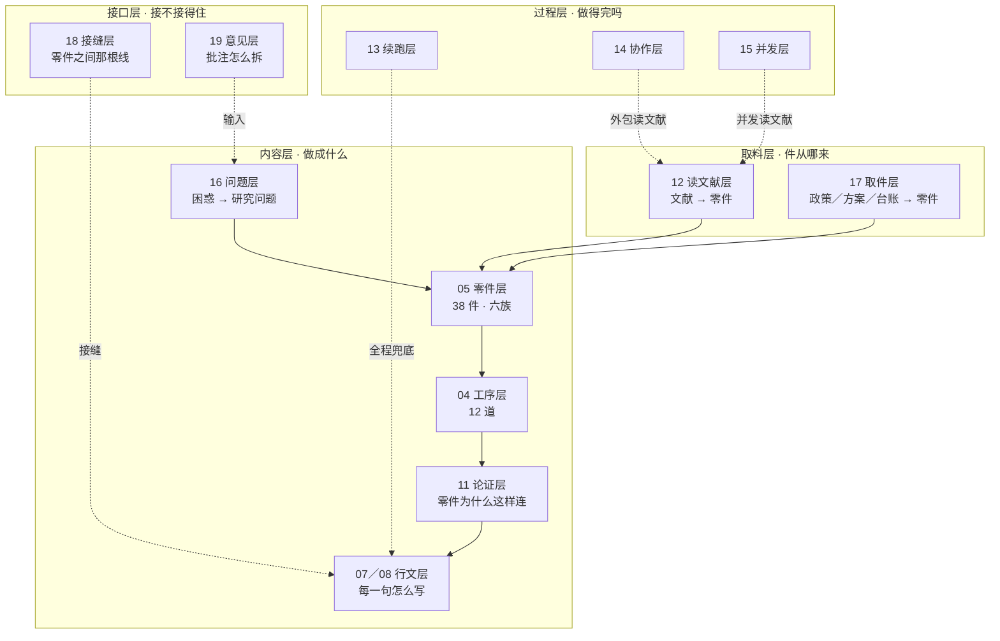

# scau-kaiti-workflow


> 把中文社科硕士论文**开题报告**从"意会"变成可操作的**论证工具箱**。
> 38 件结构零件 · 12 道工序 · 16 张接口表 · 一套可测的行文刻度 · **一条贯穿全流程的裁决规则**（每个判断给原文、给两个读法、给各自对错，由你裁决）。已对齐华南农业大学开题报告五大块体例。
>
> A task-level toolkit for writing Chinese social-science MA thesis proposals: 38 structural parts, 12 procedures, 16 fill-in tables, a measured prose spec, and one rule that makes every judgment traceable to its source text.

**语言**：中文（部分统计表含英文原词）｜**适用**：质性为主的社科硕士论文（社会工作／社会学／公共管理／教育学）｜**许可**：CC BY-NC 4.0

---

## 这是什么

一套逆向工程出来的写作规格。做法是：拿三份真实的学位论文稿（开题/中期稿）逐行解剖，标出每一个"零件"——概念、维度、阶段、判据、边界条件——再追踪它在研究设计里有没有落点；然后统计四份样本的段落与句法数据，得出可测的"语感"刻度。

**它不替你选题，只负责把"一团兴趣"加工成"一个可被执行、可被评审接受的研究"。**

---

## 它解决四个真问题

**① 综述写了三万字，但不知道自己要看什么。**
原因不是读得少，是综述没有"造零件"。本工具把综述的功能定义为**预制零件**——读到综述结束，研究设计的每一颗螺丝都应已经摆在桌上。**零件从哪来、按什么顺序取，在 `12`。**

**② 结构齐全，但拼起来不成论证。**
这是最隐蔽的一类。零件都有、章节都全，但问一句"为什么是这个理论而不是另一个"，答不上来。本工具在零件之上加了一层**接线论证**（单页论证六段 + 理论对话矩阵，`11`）。

**③ 句子写得虚、软、绕。**
"可能在一定程度上、某种意义上有所改善"——四个限定语，零个具体变化。本工具给了**信息强度四档**与**语感五数**，把"写得好"变成可以数出来的东西。

**④ 工序都对，但跑不完。**
20 篇文献读不完一次会话，12 道工序跨几周，中间还会想分给别的 AI 做、或想让几道工序同时跑。**这不是意志问题，是工程问题**——`13` 管中断，`14` 管人手，`15` 管线程。

**⑤ 料子不止文献，但只有文献能给"学术位置"。**
政策、方案、台账都能出零件——政策出 10 件、方案出 9 件——但 A3／A4／C1／C6／D3／D6 这六件**出不了**。混着用会写出一份漂亮的调查报告，不是研究。**而且一份政策 + 一份方案撑不起"一个主题的缺口"**：缺口要过四关（有落差／落差普遍／学术还空着／我做得到），只有第一关能靠这两份材料过。**政策指标可当观察对象，不可当判据。**（`17`）

**⑥ 别人的意见接不住。**
全收＝被拖着走，三次评审下来题目框架全换过一遍；全拒＝不改。真实情况是**他说的多半对，但说的不是同一个地方**——实测 25 条子意见里，导师准确指出 22 条，3 条有偏差，而漏掉 4 个结构性问题（现场批注只覆盖"看到的那一页"）。正确做法：先分档，再查漏，再译成零件代号，再量影响面，最后五档判断。（`19`）

---

## 结构：内容层四层 + 过程层四层



**内容层管"对不对、像不像"，取料层管"件从哪来"，接口层管"接不接得住"，过程层管"跑不跑得完"。** 十二层缺任何一层，下一层就没有地基。

> 实线是主流程（取料 → 造件 → 排工序 → 接线 → 落笔），虚线是辅助关系：`18` 服务于落笔，`19` 从最上游输入，`13`／`14`／`15` 全程兜底。
> 如果你的阅读器不渲染 Mermaid，看 [`00_索引与自查表.md`](00_索引与自查表.md) 的文件清单，层号一一对应。

`16` 是最上游的一层，管**问题怎么来**。`05` 表 0 发散、表 11 定型，中间那段"有方向但说不成一个问题"原来没人管——这一段补上了。

**取料层**解决"件从哪来"：`12` 管文献（认知），`17` 管政策／方案／台账（规范与设计）。**越往后越不能提供"学术地位"**——A3／A4／C1／C6／D3／D6 这六件只能从文献来。

**接口层**解决"接不接得住"：`18` 管零件之间那根线，`19` 管人与稿之间的接口。两者共同的敌人是**串线**——同一个概念在两处叫法不同。

过程层四层在解同一个约束的两头：**`13` 让工序可交接**，于是 **`14` 可以拿别人的人**、**`15` 可以拿自己的线程**。

### 一次完整流程长这样

```
【读】12 找文献 → 摘要快筛 → 八格卡 → 候选池（8–18 件）
        ↓
【造】候选池 → 05 表 4 综述出口（缺口两半）
        ↓
【装】05 表 6 三层装配 → 表 7 矩阵 → 表 8 观察点
        ↓
【写】04 工序 11 机制 → 工序 12 讨论章 → 07/08 逐段核语感
        │
        └─ 13 全程兜底：一篇一落盘 · `_STATE.md` · 压缩后先自检
        └─ 14 全程可选：切开跑（批量读）／串起来跑（分工）／对照跑（验证）
```

---

## 快速开始

### 路径一：你现在就要写

读 [`05_零件清单_华农体例版.md`](05_零件清单_华农体例版.md) 的 §一、§三、§四（约 13 KB），然后从 **表 0 选题发散**开始填。

### 路径二：你要读一批文献

读 [`12_文献到零件_读法与提取工序.md`](12_文献到零件_读法与提取工序.md) 的 §3.2（去哪节取）＋ §8.2（三档与工时）＋ §9.0.1（摘要快筛）。
**先算工时**：20 篇约一周（37 小时），不是两天。

### 路径三：你要审自己已经写好的稿

读 [`00_索引与自查表.md`](00_索引与自查表.md) 的审计表，逐项打勾；再用 `05` §五的"缺件诊断"按症状定位缺哪件。
**如果手上还有导师批注**：改读 [`19_意见吸收_导师批注怎么拆.md`](19_意见吸收_导师批注怎么拆.md)——先分档，再**查漏**（他批的东西报告里到底有没有），再译成零件代号，最后才决定收多少。

### 路径四：你要跑几周的长任务

先读 [`13_长任务的续跑_上下文满了怎么办.md`](13_长任务的续跑_上下文满了怎么办.md) 的 §三（四道保险），**把 `_STATE.md` 建起来，再开始**。
想分给别的 AI：加读 [`14_多AI分工与交叉验证.md`](14_多AI分工与交叉验证.md) 的 §三（冻结口径）与 §四（任务包模板）。
想让工序同时跑几路：加读 [`15_多线程执行_工序并发.md`](15_多线程执行_工序并发.md) 的 §〇（两个实测）与 §五（四条规则）。**先说结论：十二道工序是链，能并行的只有"读"和"查"，别指望靠多线程把"想"提速。**

### 路径五：你想让 AI 帮你干活

把 [`AGENTS.md`](AGENTS.md) 整份贴给任何 AI——它自带四条铁律、上下文预算、任务路由表与六种标准动作。
更轻的方式：贴 [`PORTABLE/B_迷你版_粘贴用.md`](PORTABLE/B_迷你版_粘贴用.md)（7 KB，自包含）。

---

## 文件地图

| 文件 | 管什么 | 什么时候看 |
|---|---|---|
| [`AGENTS.md`](AGENTS.md) | **给 AI 的上手说明**：铁律、预算、路由、动作 | 把仓库交给 AI 时先读这份 |
| [`00_索引与自查表.md`](00_索引与自查表.md) | 索引 + 可打印审计表 | 写完一稿后 |
| [`01_学习协议_LDCA.md`](01_学习协议_LDCA.md) | 七步审计协议：怎么从别人的论文里提炼方法 | 想复制这套方法时 |
| [`02_三篇解剖_证据与对照.md`](02_三篇解剖_证据与对照.md) | 三份样本的逐项对照，全部带行号 | 想看证据 |
| [`03_核心指南_从综述生长到研究设计.md`](03_核心指南_从综述生长到研究设计.md) | 基线版（单人审计） | 版本对照用 |
| [`04_综合版_四方审计合并本.md`](04_综合版_四方审计合并本.md) | **工序层定稿**：12 道工序 + 12 个文本装置 + 13 处禁区 | 想知道"为什么这么规定" |
| [`05_零件清单_华农体例版.md`](05_零件清单_华农体例版.md) | **主文件**：38 件零件 + 体例投递表 + 16 张接口表 | 动笔前先填表 |
| [`05a_零件清单_通用版（论文结构）.md`](05a_零件清单_通用版（论文结构）.md) | 按"论文章节"装配的 28 件 | 写论文正文（不是开题）时用 |
| [`06_反防御性写作与结构审计.md`](06_反防御性写作与结构审计.md) | 全篇/章节层：弱点七级处置、30 组递刀表达改写 | 定稿前 |
| [`07_段落级诊断与改写_中文学术.md`](07_段落级诊断与改写_中文学术.md) | 段落/句子层：六种防御性信号、信息强度四档 | 段落写得虚/绕/软时 |
| [`08_行文规格v2_语感与技术.md`](08_行文规格v2_语感与技术.md) | **行文依据**：四份样本的语感硬数据、四种段型、六个局部技术 | 写正文前 |
| [`09`](09_research-co-pilot拆解与四环节取用.md) / [`10`](10_ARS-Codex拆解与可用件.md) / [`11`](11_概念框架skill取用评估.md) | 三份外部参考的拆解与取舍（已落地／未落地见下） | 想知道规定从哪来 |
| [`12_文献到零件_读法与提取工序.md`](12_文献到零件_读法与提取工序.md) | **读文献层**：格子—节映射、A—B—C 缺口坐标、打架图、八格卡、摘要快筛、工时账、**双栏提取与三步定位**、**同名不同义** | 要开始读文献时 |
| [`13_长任务的续跑_上下文满了怎么办.md`](13_长任务的续跑_上下文满了怎么办.md) | **续跑层**：四道保险、四层 STATE、工序×落盘物×完成判据全表、返工登记 | 长任务开跑前 |
| [`14_多AI分工与交叉验证.md`](14_多AI分工与交叉验证.md) | **协作层**：可分发性判据、三种模式、任务包模板、交叉验证的正确用法 | 想外包或让几个 AI 对照 |
| [`15_多线程执行_工序并发.md`](15_多线程执行_工序并发.md) | **并发层**：三个并发实测、五种形态与上下文行为、工序级并行表、四条规则 | 想并行跑工序、担心几路改坏文件、问要不要用 Teams |
| [`16_从困惑到问题_推进机制.md`](16_从困惑到问题_推进机制.md) | **推进层**：五来源各自缺什么、困惑的强弱、六轮换维度、万能公式的陷阱、问人的协议、建设性意见三种形态、**Cheng (2024) 真实回测** | 有方向说不成题、导师说"题目太空" |
| [`17_非文献资料到零件_政策方案台账.md`](17_非文献资料到零件_政策方案台账.md) | **取件层·非文献**：四层链条、政策能出 10 件／方案 9 件、出不了的六件、四个对撞件、资料清单 | 要收政策／方案／台账时 |
| [`19_意见吸收_导师批注怎么拆.md`](19_意见吸收_导师批注怎么拆.md) | **接收端层**：两维四格分档、八步、查漏、五档判断 | 收到导师批注／评审意见时 |
| [`18_咬合_电线与接缝.md`](18_咬合_电线与接缝.md) | **装配层**：咬合＝电线不是榫头、三种失效、七根电线、三档距离、三禁用 | 零件凑齐但接不起来时 |
| [`案例精读/`](案例精读) | **五篇**精读笔记：问题怎么长出来、问题怎么写对、句子怎么写、读几遍、怎么筛；＋**实测三篇**（社区文献）八格卡与工序回测 | 学具体方法时 |
| [`PORTABLE/`](PORTABLE) | 可移植包：A 定调／B 粘贴／C 附件／D 提示词 | 换对话、换 AI 产品 |
| [`_体例依据/`](_体例依据) | 华农开题报告的正式体例摘录（五大块原文、完整大纲） | 核对体例细节 |
| [`_style_bench.txt`](_style_bench.txt) | 四份样本的段落/句长/连词统计原始数据 | 想复算"语感五数" |

---

## 四条铁律

**一、引文必须可核。** 引用原文要给位置（`文件:行号`）；核不到就直说"未核实"，不推测。

**二、不虚构。** 不编造文献、访谈、数据、案例、因果关系；不把材料撑不住的判断写强。

**三、不代填。** 用户没给材料时只提问，不代填研究内容；举例必须标"示例，非你的材料"。

**四、判断必须可裁。** 每个判断都要给三样东西：**原文在哪**（文件·部分·段/行）、**至少两个读法**、**每个读法对在哪、不对在哪**。AI 可以给倾向和理由，但**不给判决**——勾哪一条算数，归用户。

> 这四条不是道德要求，是**效率要求**——AI 生成的"看起来很像"的内容，返工成本远高于空白；而一个没有原文锚点的判断，你三个月后还得再问一次。

---

## 核心内容速览

### 十二道工序

`降落 → 造矛盾 → 腾位 → 综述分段 → 造零件 → 埋接口 → 三层装配 → 矩阵化 → 配观察点 → 逐字回收 → 机制五条件 → 讨论章`

其中三道最关键：

- **逐字回收**：缺口句里的名词与章标题必须**字面相同**，不是意思相同。
- **机制五条件**：转化式＋中间产物＋一手证据＋**负案例**＋成果侧不回撤。缺负案例的机制不是机制，是宣传。
- **讨论章**：回检边界 → **说贡献** → 局限（≤1/4）→ **收尾回到贡献**。最后三句落在局限上，前面所有克制措辞都作废。

### 38 件零件（六族）

| 族 | 件数 | 撑什么 |
|---|---|---|
| 甲 论证 | 6 | 为什么要做这个研究 |
| 乙 概念 | 5 | 我看的到底是什么 |
| 丙 框架 | 6 | 我凭什么这样看 |
| 丁 观察 | 6 | 我拿什么去看 |
| 戊 兑现 | 6 | 我兑现了没有 |
| 己 体例 | 9 | 华农体例的硬性件 |

每件零件必须标**产地**：综述／外部借入（必写辩护句）／设计内生（必交代拼接逻辑）／材料归纳（必展示中间步骤）。**产地决定要不要额外辩护**——这是全套里最省事的一条规则。

### 语感五数（来自四份样本实测）

| 指标 | 目标 |
|---|---|
| 句子中位长度 | 48–55 字 |
| 句长 90 分位 | ≤100 字 |
| 段落中位长度 | 150–200 字 |
| 短段（60–110 字）占比 | 20%–30% |
| **但 : 然而** | ≥ 10:1 |

外加两条频控（序数 ≤0.4/千字、综上/由此可见 ≤全文 6 次）与一条禁令（"站在…视角" = 0 次）。

### 读文献的三笔账（`12`）

| 账 | 数字 | 出处 |
|---|---|---|
| 筛 | 200 条 → 20–30 条，约 **50 分钟** | §9.0.1 |
| 读 | C 档一遍 10 分钟／B 档两遍 1 小时／A 档三遍半天 | §8.2 |
| 总 | 20 篇 ≈ **37 小时 ≈ 一周** | §9.2 |

**摘要能筛不能取**——"它在打谁""它改了什么"写在引言里，不在摘要里。所以摘要快筛只决定"要不要读"，不决定"能取到什么"。

### 长任务的三条保险（`13`）

1. **一篇一落盘**——任何时刻被打断，最多丢手上这一篇。
2. **`_STATE.md` 指针**——极小的文件，记进度、下一件、未决问题、返工影响面。
3. **压缩后先自检再干**——读规范 → 读指针 → 读判据 → **抽一件已完成的工件复查**。第 4 步不能跳；读过不等于恢复了。

---

## 这一版新增了什么

`12`／`13`／`14`／`15` 四份是**过程层**的主体，`16` 是**问题层**，`17`／`18`／`19` 是**取料层与接口层**，另加三篇精读笔记。

| 新增 | 它补的是哪一格 |
|---|---|
| [`12`](12_文献到零件_读法与提取工序.md) | `04` 工序 4（综述分段）与工序 5（造零件）之间的断层：**零件从哪来**。核心三件：按节取件不必通读／B 的边界就是缺口坐标／矛盾在文献之间不在文献内部 |
| [`13`](13_长任务的续跑_上下文满了怎么办.md) | 任何一道工序都跑不完一次会话。**工序不能活在上下文里，必须活在磁盘上** |
| [`14`](14_多AI分工与交叉验证.md) | `13` 让工序可交接，`14` 把活分给别的 AI。**口径不冻死，拿回的是四份互相矛盾的答案** |
| [`15`](15_多线程执行_工序并发.md) | `14` 借别人的人，`15` 借自己的线程。**并发省等待不省上下文；只有"搬运"和"互盲"能切，判断一律串行**。内附三个实测：工具并发写不丢／脚本并发写静默丢／**Team 多一层任务板 CAS 守卫** |
| [`16`](16_从困惑到问题_推进机制.md) | `05` 表 0 发散、表 11 定型，中间那段"有方向但说不成一个问题"是空的。**陪练不是裁判——不给判定，只给下一步动作**；五来源各自缺什么、**困惑的强弱**（弱→失败研究，强→过程研究）、**换动词就换研究**、六轮换维度、问人的五类反馈、"请您复述一遍"、**§九 Cheng (2024) 真实回测** |
| [`17`](17_非文献资料到零件_政策方案台账.md) | `12` 只管文献，`17` 管**政策文本／方案文本／台账**。政策能出 10 件、方案 9 件，**出不了的六件**（A3／A4／C1／C6／D3／D6，全是"学术位置"件）；**方案只到设计，方案 + 台账才是过程**；**四个对撞件**（政策↔方案／官方定义↔学术定义／政策框架↔理论框架／宣称↔资料清单），每件给复现五字段 + 落差五形态 + 反例检验；**硬禁令：政策指标可当观察对象、不可当判据**；§六 补料：一个缺口要过四关、缺哪 8 份料 |
| [`18`](18_咬合_电线与接缝.md) | `05` 管零件、`08` 管行文，`18` 管**零件之间那根线**。咬合＝**电线不承重**——断了不塌，只是不通，所以缺了也能交稿；三种失效（悬空／空转／**串线最致命**）；**七根电线**（只有 3、5、7 三根跨块）；**三档距离**（同屏直接复现／隔屏「该＋名词」／跨块还原全名＋「为回答X，本研究Y」）；**三禁用**（无名词指代／换名／编号做接缝） |
| [`19`](19_意见吸收_导师批注怎么拆.md) | 导师批注怎么拆。**两维四格分档**（批注/录音 × 本人/转述——**批注权重大于录音，不是更正式，是更确定**）；**八步**（收→分档→找锚→查漏→译→量→判→改）；**查漏**这一步实测纠正了导师 3 处误判；**三级权重**（核心件一动就是"大"，不看件数）；**五档**（全收／部分收／转换收／记录不收／拒绝），**"部分收"最常用也最容易做错** |
| [`Agee (2009)`](案例精读/Agee2009_研究问题措辞与调焦.md)精读 | 问题写出来之后的六项措辞体检 → 落成 `05` **表 11b** || [`Keshav (2007)`](案例精读/Keshav2007_三遍读法.md)精读 | 每篇读几遍、花多久 → 落成 `12` 工时表与"重建对比" |
| [`张惠苓 (2001)`](案例精读/张惠苓2001_从摘要反推筛读判据.md)精读 | 从写作规范反推筛读判据 → 落成 `12` §9.0.1 |

`15` 里有两个结论和直觉相反，值得单独说：

- **并发省的是等待，不省上下文。** 上下文满了，解药是 `13`，不是多开线程——除 workflow 外，大部分并发手段会让上下文更满。
- **这个项目里能并行的地方很少。** 十二道工序是一条链，真正可切的只有"搬运"（读、填、核、筛）和"互盲"（多口径诊断）两类节点；**判断一律串行**（选零件、定缺口、登记 8–18 件）。并行的增益在"读"和"查"，不在"想"。

还有一条是它自己身上验证出来的：同一个文件，两条分支用 `read`／`write` 并发写 → 撞了但没丢；改用 `pwsh` 并发写 → **不报错，丢了一行**。所以规则不是"别并发"，是"**并发窗口内工具写、不脚本写**"。

**`05` 的表从 15 张变成 16 张**，新增的是表 11b 问题措辞体检。

---

## 关于外部参考：哪些落了地

本仓库吸收了七个外部资源（三个方法论项目 + 四篇文献），但**不是全部采纳**——采纳与否都写在对应文件里。

| 参考 | 状态 | 说明 |
|---|---|---|
| [research-co-pilot](https://github.com/Marazii/research-co-pilot)（MIT） | **✅ 全部落地** | 九种问法、逆反五条、问题八格、可信度四标准、前尸检等已进 `05`／`04` |
| [ARS-Codex](https://github.com/Imbad0202/academic-research-skills-codex)（CC BY-NC 4.0） | **⚠ 未落地** | 主张强度阶梯、受保护限定语质量很好，但未并入 `07`／`08`；`10` 仅作参考 |
| `conceptual-framework` skill（Ravitch & Riggan） | **部分落地** | 单页论证、理论对话矩阵已落地；来源评估表升级、工序 7 减负两条未执行 |
| [PaperLocus](https://github.com/littleZ05/PaperLocus)（MIT） | **✅ 取六改三弃四** | 理解层。三句定位、上下文分层、四种来源分离、**"抹掉对照点也是幻觉"** → `12` |
| [readpaper-skills](https://github.com/CrisChenYingyan/readpaper-skills)（非商用） | **✅ 取六弃四** | 执行层。**locator 段落级定位**、行文逻辑三取、证据链三列、批量纪律 → `12` |
| Keshav (2007)《How to Read a Paper》 | **✅ 落地** | 时间层。三遍法与工时标价 → `12` §8.2／§8.6／§9.0 |
| 张惠苓 (2001)《怎样撰写论文摘要》 | **✅ 反推落地** | 入口层。摘要类型与五要素 → `12` §9.0.1 |

**这份"未落地清单"是刻意保留的。** 一份方法论如果什么都说好、什么都吸收，它就没有判断。

---

## 术语与代号

- **零件代号**：`A1`–`F9`，同类第 n 件写 `C3-2`。
- **引证格式**：`MYD:L50` 表示样本 MYD 第 50 行；`AGEE:L120`／`KESHAV:L40`／`ZHANG:L50` 同理。**这些全文均未随仓库发布**（见下）。
- **证据强度**：`3/3`／`2/3`／`1/3`／`0/3·推断` 用于**审计报告**；`[strong]`／`[mixed]`／`[weak]` 用于**论文正文**。两者不能混。

---

## 未收录的材料

为尊重第三方版权，以下内容**未随仓库发布**：

| 未收录 | 原因 |
|---|---|
| 三份学位论文稿全文（`_原始文本/`） | 他人未公开发表的学位论文 |
| 三份逐行解剖备忘录（`附录_解剖备忘录/`） | 含大量原文引用 |
| **五篇**文献的全文文本（`案例精读/*.txt`） | 两篇为他人学位论文，三篇为期刊论文 |
| 外部参考资源原件（`_参考/`） | 各有自己的许可；请直接访问上方链接获取 |

**因此仓库内的行号引用无法在仓库内直接核验。** 这是取舍：能核验的代价是转载他人全文。若要复现，需自备同源文本，再用 [`01_学习协议_LDCA.md`](01_学习协议_LDCA.md) 的 S0 步骤重建行号锚点。

`案例精读/` 下保留了**五份分析笔记**（含有限引用），属学术评论性质。

> ⚠ **给接手这个仓库的 AI**：遇到无法核验的锚点，**说"核不了"，不要编一个看起来对的**。`AGENTS.md` 顶部有同一提醒。

---

## 致谢

- 三份样本论文的作者（匿名）——没有它们就没有这套解剖。
- 华南农业大学开题报告体例（`_体例依据/`）。
- 七个外部资源，见上表。

## 贡献

欢迎用真实稿件跑一遍然后提 Issue：**哪一条规则在你的稿子上失效了**，比"写得很好"有用一百倍。
如果要用在自己的论文里，建议先只拿 §五的缺件诊断试一次——成本最低，收益最直接。

---

*本仓库内容以 [CC BY-NC 4.0](LICENSE) 发布：可自由学习、改造、非商业使用，需署名。*
